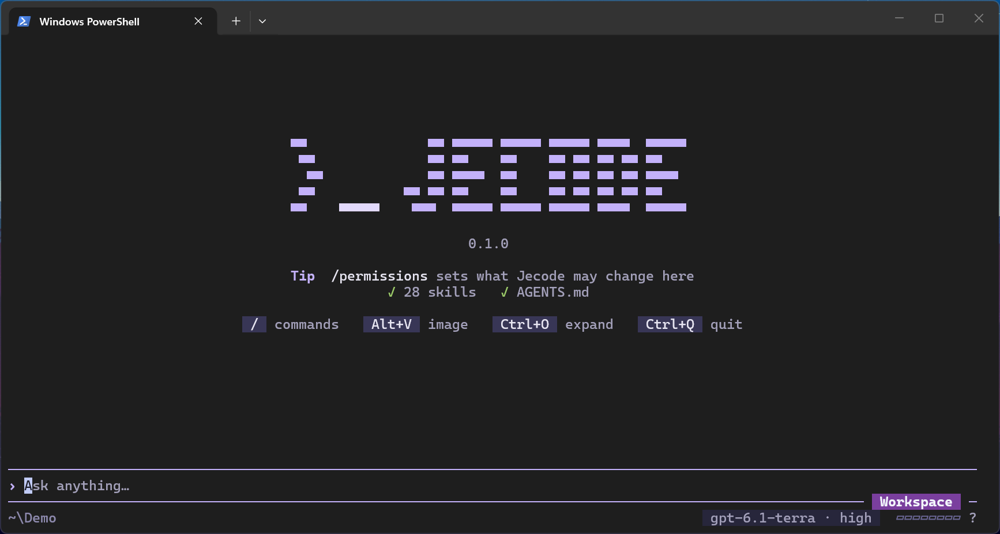

# Jecode

[](https://github.com/giovannijecha/jecode/actions/workflows/CI.yml)

Jecode is a coding agent that works in your terminal. You describe a task; the
model you choose reads your project, edits files, runs commands and checks the
result, while you watch each step and keep control of what it may change.

It is a single native executable written in Rust, without third-party Rust
crates. It connects to OpenRouter with an API key, or to your ChatGPT or
Claude subscription by signing in.

## What it looks like



Start `jecode` in a project directory and type a request, such as *"The tests in
`src/parser` fail since the last change. Find out why and fix it."* The agent
then works through the task in the same window:

- each file it reads, search it runs and command it executes appears as a compact
  card, and edits appear as diffs;
- you can keep typing to add instructions, which it picks up before its next
  step, or press Esc to stop it;
- at the default permission level, it asks you before touching anything outside
  the project directory;
- checkpoints let you inspect and restore captured file changes; each receipt
  tells you what was saved.

When you quit, Jecode prints a summary and the command to continue later:

```text
>_ jecode closed · 3 prompts · 12 tools · 4m 12s
   jecode resume 7f3a9c2e
```

You can also run one task without the fullscreen interface, or pipe one in; see
[Command line](docs/usage/CLI.md):

```sh
jecode "Explain the structure of this project"
```

## Install

Install Jecode with Node.js 22 or later and npm on Windows x64, Linux x64
(glibc 2.39 or newer), or macOS Apple silicon. The macOS build
has been tested on macOS 15; earlier versions remain unverified.

```sh
npm install -g @giovannijecha/jecode
jecode --version
```

The npm command launches a bundled native executable. It needs Node.js to
start; the standalone executable does not. To build and install from source,
see [Installation](docs/usage/INSTALLATION.md). That guide also
covers npm updates, removal, and existing standalone installations.

## First task

1. Open a terminal in the project you want to work on and run `jecode`.
2. Connect a provider: type `/settings`, choose **Providers**, then either
   **API keys** → **OpenRouter** and paste an
   [OpenRouter key](https://openrouter.ai/settings/keys), or **Credentials** →
   **OpenAI** or **Anthropic** → **Add account** and sign in in your browser.
3. Choose a model when the selector opens. This saves your configuration.
4. **On Linux and macOS**, type `/permissions full` if the agent should run
   commands. The default level, Workspace, confines commands only on Windows and
   refuses them elsewhere; see [Permissions](docs/usage/PERMISSIONS.md).
5. Type your task and press Enter.

Instead of steps 2 and 3, you can run `jecode setup` for a guided prompt.

To continue later, run `jecode resume` from the same directory. Press Ctrl+Q to
quit, and `/help` or F1 for commands and common shortcuts.

## Learn more

- [Providers](docs/usage/PROVIDERS.md): account setup, usage and provider-specific
  compatibility limits.
- [Terminal interface](docs/tui/INTERFACE.md): sending, queueing, stopping and
  reading the agent's work.
- [Permissions](docs/usage/PERMISSIONS.md): what the agent may do, and approvals.
- [Project instructions](docs/usage/PROJECT_INSTRUCTIONS.md): give the agent
  your project's rules with `AGENTS.md`.
- [Checkpoints](docs/usage/CHECKPOINTS.md): undo changes made by a tool call.
- [Documentation index](docs/README.md): every guide and reference.

## Status

Jecode is at version 0.1.0: usable, and still evolving. Commands, settings and
storage formats may change between releases.

- Windows is the primary platform. Linux and macOS are built and tested in CI;
  interactive use on macOS has not been verified. See
  [Platform support](docs/development/PLATFORMS.md).
- Command confinement in the Workspace permission level exists only on Windows.
- OpenAI and Anthropic API keys are not supported.

## Privacy and security

Jecode sends your conversation, including file contents and command output the
agent has read, to the provider you select. Your OpenRouter key, account
tokens, conversations and checkpoints are stored locally under `~/.jecode/`. See
[SECURITY.md](SECURITY.md) for details and how to report a vulnerability.

## Contributing

Read [CONTRIBUTING.md](CONTRIBUTING.md) and
[Development and testing](docs/development/TESTING.md).

Jecode is released under the [MIT license](LICENSE).
