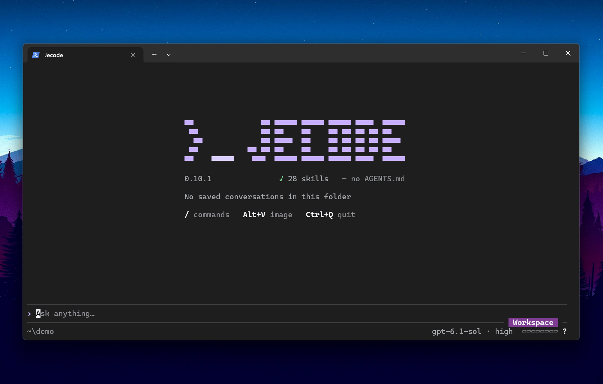

# Jecode

[](https://github.com/giovannijecha/jecode/actions/workflows/CI.yml)

Jecode is a coding agent for your terminal. You describe a task; the model you
choose reads your project, edits files, runs commands and checks
the result, while you watch each step and control what it may change.

It is a single native executable written in Rust, without third-party Rust
crates. Connect an OpenRouter, OpenAI or Anthropic API key, or sign in with
your ChatGPT account. A Claude subscription compatibility route is also
available; read the [provider caveat](docs/usage/PROVIDERS.md#claude-account).



*Jecode 0.10.1 in Windows Terminal, with GPT-6.1 Sol selected.*

## Install

Install with Node.js 22 or later and npm on Windows x64, Linux x64 or macOS
(Apple silicon or Intel). Check [Platform support](docs/usage/PLATFORMS.md)
for verification status, minimum OS versions and Node.js support.

```sh
npm install -g @giovannijecha/jecode
jecode --version
```

The npm command launches a bundled native executable. It needs Node.js to
start; the standalone executable does not. To build and install from source,
see [Installation](docs/usage/INSTALLATION.md). That guide also
covers `jecode update`, `jecode uninstall`, and existing standalone installations.

## First task

1. Open a terminal in the project you want to work on and run `jecode`.
2. Connect a provider: type `/settings`, choose **Providers**, then either
   **API keys** → **OpenRouter**, **OpenAI API** or **Anthropic API** and paste
   that provider's key. **Credentials** offers ChatGPT sign-in and the
   documented Claude compatibility route.
3. Choose a model when the selector opens. This saves your configuration.
4. Type your task and press Enter. The default permission level, Workspace,
   asks for approval for file access outside the project. See
   [Permissions](docs/usage/PERMISSIONS.md) for command confinement and platform
   requirements.

Instead of steps 2 and 3, you can run `jecode setup` for a guided prompt.

To continue later, run `jecode resume` from the same directory. Press Ctrl+Q to
quit, and `/help` or F1 for commands and common shortcuts.

## Work in your project

Start `jecode` in a project directory and type a request, such as *"The tests in
`src/parser` fail since the last change. Find out why and fix it."* The agent
then works through the task in the same window:

- each file it reads, search it runs and command it executes appears as a compact
  card, and edits appear as diffs;
- you can keep typing to add instructions, which it picks up before its next
  step, or press Esc to stop it;
- `/permissions` changes the conversation's permission level and lets you
  review remembered approvals;
- `/` lists commands as you type, and Ctrl+G opens them without touching your
  draft;
- `$` picks one of your personal skills and `@` a project file, written into the
  message as references the agent reads when it needs them; see
  [Reference skills and files](docs/usage/INTERFACE.md#reference-skills-and-files);
- Auto, Dark and Light themes keep your terminal's own background;
- long conversations keep their original history available after compaction;
  see [Long-running work](docs/usage/LONG_WORK.md);
- `/process` lets you inspect running commands; see
  [Processes](docs/usage/INTERFACE.md#processes).

When you quit, Jecode prints a summary and the command to continue later:

```text
>_ jecode closed · 3 prompts · 12 tools · 4m 12s
   jecode resume 1793721600123-4812-0
```

You can also run one task without the fullscreen interface, pipe data into it,
or manage Jecode from your shell; see [Command line](docs/usage/CLI.md):

```sh
jecode "Explain the structure of this project"
git diff | jecode "Review this diff"
jecode resume --last "Now add the missing test"
jecode doctor
jecode update
```

## Learn more

- [Providers](docs/usage/PROVIDERS.md): account setup, usage and provider-specific
  compatibility limits.
- [Terminal interface](docs/usage/INTERFACE.md): sending, queueing, stopping and
  reading the agent's work.
- [Permissions](docs/usage/PERMISSIONS.md): what the agent may do, and approvals.
- [MCP connections](docs/usage/MCP.md): connect remote tools from Settings.
- [Language servers](docs/usage/LSP.md): query definitions, references and diagnostics.
- [Project instructions](docs/usage/PROJECT_INSTRUCTIONS.md): give the agent
  your project's rules with `AGENTS.md`.
- [Documentation index](docs/README.md): every guide and reference.

## Status

Jecode is experimental. The [release notes](CHANGELOG.md) track changes to
commands, settings and storage. Jecode resumes conversations saved in its
current format and preserves files from older formats. See
[Sessions](docs/usage/SESSIONS.md) for recovery and upgrade behavior.

CI builds and exercises terminal fixtures for Windows x64, Linux x64, and
macOS on Apple silicon and Intel. Windows and Linux have recorded live-provider
use. Interactive use on macOS still needs verification. See
[Platform support](docs/usage/PLATFORMS.md) for requirements and coverage.

The [performance measurement guide](docs/development/PERFORMANCE.md) explains
how to measure Jecode's components and compare agent runs. The
[report index](docs/reports/README.md) lists dated results and their scope.

## Privacy and security

Jecode sends your conversation, including file contents and command output the
agent has read, to the provider you select. See [Security](SECURITY.md) for
credential storage, local data and how to report a vulnerability.

## Contributing

Read [CONTRIBUTING.md](CONTRIBUTING.md) and
[Development and testing](docs/development/TESTING.md).

Jecode is released under the [MIT license](LICENSE).
