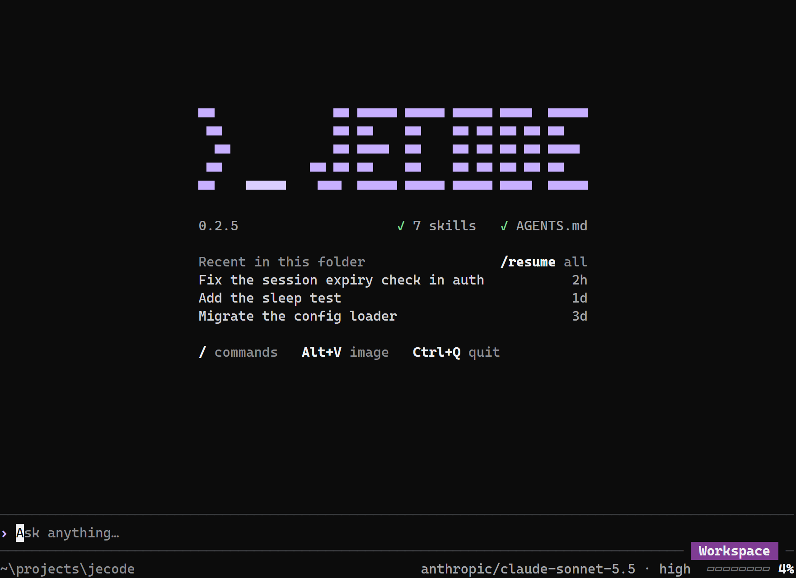

# Jecode

Jecode is a coding agent for your terminal. Choose a model, describe a task,
and let it read your project, edit files, run commands and check
the result. Tool cards and diffs show the work as it happens.



*Jecode 0.7.5 in Windows Terminal, with GPT-6.1 Sol selected.*

## Install

Install with Node.js 22 or later and npm:

```sh
npm install -g @giovannijecha/jecode
jecode --version
```

The package includes native executables for Windows x64, Linux x64 and macOS
on Apple silicon or Intel. Check [system requirements](https://github.com/giovannijecha/jecode/blob/main/docs/usage/PLATFORMS.md#supported-versions)
for minimum OS versions, libraries and Node.js support. The launcher needs
Node.js; a standalone build does not.

## First task

Run `jecode` in your project, open `/settings` and choose **Providers**. Connect
an OpenRouter, OpenAI or Anthropic API key, or sign in with ChatGPT, then select
a model. A Claude subscription compatibility route is also available; read the
[provider caveat](https://github.com/giovannijecha/jecode/blob/main/docs/usage/PROVIDERS.md#claude-account).
API keys use API billing separately from subscription plans.

Type a task and press Enter. Esc stops a turn, Ctrl+Q quits, and `jecode resume`
continues saved work. `/help` or F1 lists commands and shortcuts. See the
[terminal guide](https://github.com/giovannijecha/jecode/blob/main/docs/usage/INTERFACE.md).

Type `$` to choose a personal skill or `@` to browse project files. References
appear as editable cards in the composer; Tab on a reference reopens its
selector. See [Reference skills and files](https://github.com/giovannijecha/jecode/blob/main/docs/usage/INTERFACE.md#reference-skills-and-files).

The default permission level is Workspace; see [Permissions](https://github.com/giovannijecha/jecode/blob/main/docs/usage/PERMISSIONS.md)
for command confinement, approvals and platform limits. Read
[Security](https://github.com/giovannijecha/jecode/blob/main/SECURITY.md) for data
sent to providers and local credential storage.

## Update or remove

Read the [release notes](https://github.com/giovannijecha/jecode/blob/main/CHANGELOG.md)
before updating: this build resumes only conversations in its current format
and leaves unsupported files unchanged. The
[installation guide](https://github.com/giovannijecha/jecode/blob/main/docs/usage/INSTALLATION.md#update-or-remove-the-npm-installation)
covers npm updates, removal and existing standalone installations.

The [project README](https://github.com/giovannijecha/jecode#readme) and
[documentation index](https://github.com/giovannijecha/jecode/blob/main/docs/README.md)
cover the full workflow and references.
